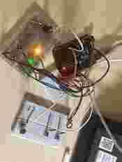
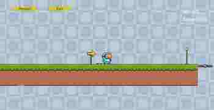

# Scream and Shout

**A two-player Unity × Arduino interactive 2D platformer.**

This course project explores **physical–digital interaction**: instead of controlling a platform game entirely with a keyboard, two players can use Arduino-connected controls to influence the same real-time game. Player 1 races toward the finish; Player 2 tries to stop them by spawning monsters and obstacles.

Built with **Unity 2022.3.61f1c1 · C# · Arduino serial communication**. The repository also contains a **Unity WebGL build** with keyboard and browser-microphone input support.

## Project preview

<table>
  <tr>
    <td align="center" width="42%"></td>
    <td align="center" width="58%"></td>
  </tr>
  <tr><td align="center"><sub>Physical controller prototype (photo from project documentation)</sub></td><td align="center"><sub>Unity side-scrolling game (screenshot from project documentation)</sub></td></tr>
</table>

## How the two-player interaction works

| Role | Physical inputs | Effect in Unity |
| --- | --- | --- |
| **Player 1 — Runner** | Run button, jump button, microphone | Move, jump/double-jump, and (in voice-speed mode) change running speed through sound intensity |
| **Player 2 — Challenger** | Monster-spawn button, obstacle-spawn button, potentiometer, cooldown LEDs | Spawn a pursuing monster behind Player 1, place an obstacle ahead, adjust monster speed, and see when spawning becomes available |

Player 1 has **two speed modes**: a fixed movement speed and a microphone-responsive mode. On the original Arduino setup, microphone amplitude is smoothed and mapped to a playable speed range. Player 2's potentiometer measures movement intensity over a short time window to control monster speed rather than simply using the knob's absolute position.

In the documented Arduino prototype, the spawn controls use **15-second monster** and **8-second obstacle** cooldowns, with LED feedback. The Unity scripts additionally use edge-trigger detection, debouncing, minimum spawn intervals, and spawn-window guards to prevent unintended repeated events.

## Core features

- **Movement and platforming:** running, double-jumping, gravity, moving platforms, animation states, and camera follow.
- **Adversarial interaction:** a second player's inputs can trigger enemies or hazards relative to the runner's position.
- **Damage and recovery:** collision-based damage, health UI, checkpoint respawn, and game-over handling.
- **Complete gameplay loop:** menu, level-end trigger, completion-time display, victory/game-over panels, and restart actions.
- **Multiple input paths:** Arduino serial messages for physical controls; keyboard fallback and microphone-based speed for demonstrations without the hardware.

## Arduino → Unity communication

`Assets/SerialInput.cs` receives comma-separated values from the serial port. The documented message format is:

```text
move,jump,playerSpeed,monsterSpeed,monsterReady,obstacleReady
```

For example, the parser can receive `0,1,8,7,1,1`. Movement and jump signals are interpreted in Unity; the two `Ready` fields are used to detect a transition from **ready → not ready**, which triggers spawning once rather than once per frame.

| Arduino signal | Documented pin |
| --- | --- |
| Player 1 move / jump buttons | D2 / D3 |
| Microphone / potentiometer | A0 / A1 |
| Monster / obstacle spawn buttons | D5 / D6 |
| Monster / obstacle cooldown LEDs | D7 / D8 |

**Serial defaults:** `COM3` and `230400` baud. These settings must match the connected Arduino and can be changed in Unity's `SerialInput` Inspector. The `enableSerialInput` field is disabled by default in the script, so enable it in Unity when using a connected board.

**Source-code scope:** The Unity C# receiver and gameplay scripts are in this repository. The Arduino-side program is illustrated in the original course documentation, but no standalone `.ino` source file is included in this repository.

## Key implementation files

| File | Responsibility |
| --- | --- |
| `Assets/SerialInput.cs` | Open serial port, parse six values, guard startup state, and close connection |
| `Assets/script/Player/PlayerMove.cs` | Keyboard/serial movement, optional microphone speed, acceleration, animations |
| `Assets/script/Player/PlayerJump.cs` | Ground and double-jump logic, input-edge handling |
| `Assets/script/Monster/MonsterSpawner.cs` | Debounced, edge-triggered monster spawning with cooldown guards |
| `Assets/script/Monster/ObstacleSpawner.cs` | Obstacle spawning with the same signal-stability safeguards |
| `Assets/script/Player/HealthManager.cs` | Health state and event notifications |
| `Assets/script/Player/PlayerDead.cs` | Hazard collisions, damage cooldowns, and out-of-bounds checks |
| `Assets/script/Player/PlayerSpawnController.cs` | Checkpoints and respawn handling |
| `Assets/script/LevelEndTrigger.cs` / `GameOverUI.cs` | Victory, defeat, timers, and restart |
| `Assets/Plugins/WebGL/WebGLMicrophone.jslib` | Browser microphone volume bridge for WebGL |

## Run the Unity project

1. Clone or download this repository.
2. Open it using **Unity 2022.3.61f1c1** (or another compatible Unity 2022.3 LTS version).
3. Open `Assets/Scenes/Menu.unity` to start at the menu, or `Assets/Scenes/SampleScene.unity` to inspect the gameplay level.
4. For **Arduino controls**, connect the boards and verify the correct COM port, baud rate, and `enableSerialInput` setting on the `SerialInput` component.
5. For **keyboard fallback**, use **D / →** to move and **Space / W / ↑** to jump; **J** and **K** can trigger monster/obstacle spawning when keyboard spawning is enabled.
6. Press **Play** in the Unity Editor.

Hardware mapping, serial port availability, and behavior depend on your connected Arduino configuration and Unity Inspector settings.

## WebGL build (for browser demonstrations)

A prebuilt browser version is available in **[`WebGLBuild/`](WebGLBuild/)**. It includes the game loader, Brotli-compressed build assets, and an HTTP `_headers` configuration for static hosting. No public live-demo URL is claimed here until a deployment has been tested.

**Important:** A normal Unity WebGL page cannot directly open a Windows `COM3` serial port using the desktop `System.IO.Ports` API. The browser build should be treated as a **keyboard/microphone demonstration**, not as a drop-in replacement for the physical Arduino installation. Browser microphone input requires permission and a secure context (HTTPS or localhost).

For hosting, publish the **contents** of `WebGLBuild/` as a static site and ensure `.br` assets receive the correct `Content-Encoding: br` and MIME types. Test loading, keyboard controls, microphone permissions, and restart flow before sharing a demo link.

## Implementation and design notes

This project uses small Unity components rather than one monolithic player controller. Damage is linked to the health system through events; respawning is handled separately; spawning guards compensate for noisy or held hardware inputs. The physical controller design turns a typical solo platformer into a two-person adversarial interaction.

The screenshots above and hardware photographs were extracted from the author's course final-project documentation and compressed for fast loading.

## Assets and acknowledgment

Pixel-art character/environment assets use **[Pixel Adventure 1](https://assetstore.unity.com/packages/2d/characters/pixel-adventure-1-155360)** from the Unity Asset Store. Those visuals are third-party assets; the project's Unity/Arduino integration and gameplay scripts are separate work. Please review the original asset license before reusing or redistributing any included third-party assets.

---

*Course project: Scream and Shout — Unity, Arduino, and physical interaction design.*
