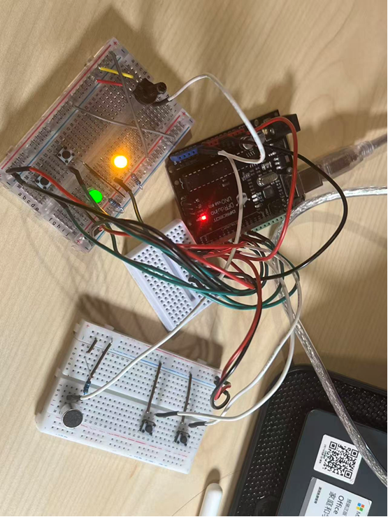
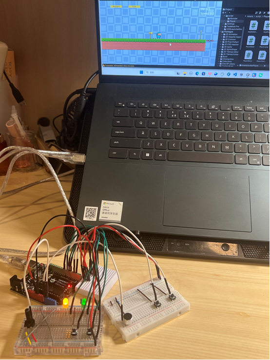
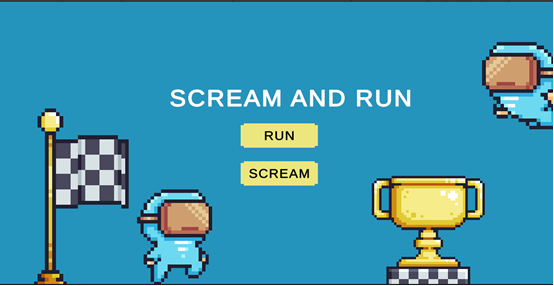
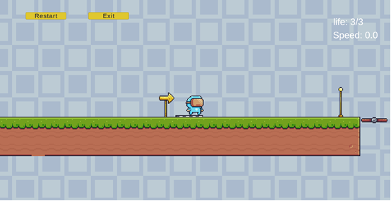
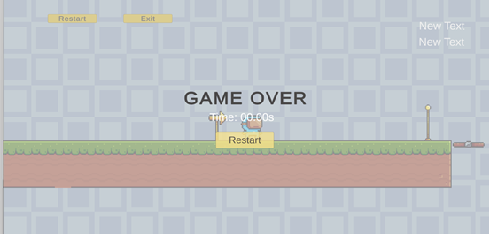
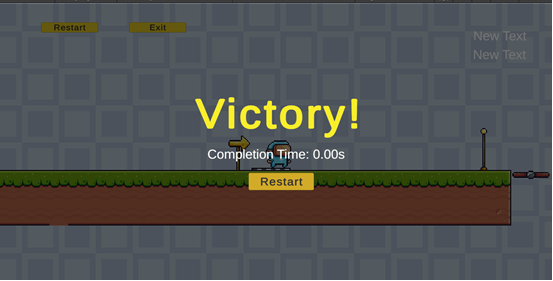

# Scream and Shout 

**A two-player, hardware-interactive 2D platformer built with Unity, C#, and Arduino.**

In *Scream and Shout*, one player races toward the finish line while the other actively tries to stop the runner by spawning monsters and obstacles. Physical controllers built with Arduino turn a traditional platform game into a real-time, asymmetric two-player experience. The runner can move and jump with physical buttons, and in voice mode their movement speed reacts to sound. The challenger can summon monsters, place obstacles, and adjust enemy speed with a potentiometer.

**Tech stack:** Unity 2022.3 LTS · C# · Arduino · Serial Communication · 2D Physics · WebGL

## 🎮 Play Online

**[▶ Play the simplified WebGL demo](https://runningame.netlify.app/)**

The online version is a playable **browser preview** of *Scream and Shout*. It demonstrates the core platforming and two-player challenge mechanics with keyboard controls, without requiring Unity or Arduino hardware.

| Player | Controls in the browser build |
| --- | --- |
| **Player 1 — Runner** | Hold **D / →** to run; **Space / W / ↑** to jump (including a second jump in midair) |
| **Player 2 — Challenger** | **J** to spawn a monster, **K** to spawn an obstacle; **Right Shift** can increase monster speed when enabled |

**Preview limitations:** The browser build does not directly connect to the physical Arduino controllers. Some UI elements (such as the exit/back-to-menu button and health display) may be missing or clipped in the current WebGL build. A browser-specific microphone interface is included for SCREAM mode; microphone permissions and compatibility vary by browser. This is a simplified demo, not a substitute for the complete hardware-integrated experience.

For the **hardware-integrated version**, clone the Unity project, upload the included [Arduino sketch](arduino/Finalgame/Finalgame.ino) to a compatible board, wire the controls as documented below, and configure the Unity serial port locally.

## Demo Gallery

### Physical controllers

<table>
  <tr>
    <td align="center" width="50%"></td>
    <td align="center" width="50%"></td>
  </tr>
  <tr>
    <td align="center"><sub>Arduino prototype: buttons, LEDs, microphone, and analog controls</sub></td>
    <td align="center"><sub>Hardware-to-Unity gameplay setup</sub></td>
  </tr>
</table>

### Gameplay and interface

<table>
  <tr>
    <td align="center"></td>
    <td align="center"></td>
  </tr>
  <tr><td align="center"><sub>Main menu — Run / Scream</sub></td><td align="center"><sub>2D platformer gameplay</sub></td></tr>
  <tr>
    <td align="center"></td>
    <td align="center"></td>
  </tr>
  <tr><td align="center"><sub>Game Over screen</sub></td><td align="center"><sub>Victory and completion time</sub></td></tr>
</table>

## How It Works

The game has two distinct roles, each using a physical controller connected through Arduino.

| | Player 1 — Runner | Player 2 — Challenger |
| --- | --- | --- |
| **Objective** | Navigate the platform level, survive traps and reach the finish | Interrupt the run by spawning hazards and enemies |
| **Controls** | Run button, jump button, microphone | Monster button, obstacle button, potentiometer |
| **Gameplay effects** | Movement, jumping, sound-responsive speed | Enemy spawning, obstacle placement, monster speed adjustment |
| **Feedback** | Speed, health, game state | Cooldown LEDs showing availability of spawn actions |

### RUN and SCREAM modes

- **RUN:** conventional, fixed-speed platforming with movement and jump controls.
- **SCREAM:** the runner's movement speed depends on microphone volume. Louder input drives higher speed within configured limits; smoothing helps avoid abrupt speed changes.

### Hardware input pipeline

Arduino sends a six-field, comma-separated message to Unity:

```text
move,jump,playerSpeed,monsterSpeed,monsterReady,obstacleReady
```

The Unity receiver in `Assets/SerialInput.cs` parses these values and passes them to the movement and spawning systems. The original controller design uses microphone readings for runner speed and changes in potentiometer position over a short time window for monster speed.

**Hardware input design:**

- Player 1: run and jump push buttons; microphone input for speed control.
- Player 2: dedicated buttons for spawning monsters and obstacles; potentiometer for monster speed.
- Cooldown indicators: LEDs indicate when spawning actions are ready.
- The hardware design specifies **15-second monster** and **8-second obstacle** cooldown periods.

On the Unity side, spawn scripts use **falling-edge triggers, debouncing, minimum spawn intervals, and one-spawn-per-cycle guards**, reducing accidental repeated activations from held buttons or noisy signals.

**Arduino firmware:** [`arduino/Finalgame/Finalgame.ino`](arduino/Finalgame/Finalgame.ino) contains the controller program used to send the six-field serial input to Unity. Upload it using the Arduino IDE after connecting the hardware.

| Arduino pin | Input or output |
| --- | --- |
| D2 / D3 | Runner: movement / jump buttons |
| A0 / A1 | Microphone / challenger potentiometer |
| D5 / D6 | Challenger: monster / obstacle buttons |
| D7 / D8 | Monster / obstacle cooldown indicator LEDs |

The sketch uses `INPUT_PULLUP` for buttons (pressed = LOW), a serial baud rate of **230400**, a **15-second monster cooldown**, and an **8-second obstacle cooldown**. Match the board's wiring and serial port to your setup; confirm your microphone sensor is compatible with the analog input and supply voltage.

## Gameplay Features

- **Player movement:** movement acceleration/deceleration, running, jumping, double jumping, ground detection, and animations.
- **Dynamic level elements:** moving platforms, saws, collisions and hazards.
- **Adversarial spawning:** monsters appear behind the runner; obstacles appear in front, with rate limiting and signal stability controls.
- **Health and checkpoints:** damage cooldown, three-life default, respawn at checkpoint, and health UI events.
- **Completion and restart:** game-over and victory screens, elapsed-time feedback, and scene restart.
- **Camera:** Cinemachine follow camera for side-scrolling play.
- **Input options:** Arduino serial hardware, keyboard fallback, and microphone-based speed control.

## Project Structure

```text
Assets/
├── SerialInput.cs                    # Arduino serial receiver
├── Plugins/WebGL/
│   └── WebGLMicrophone.jslib         # Browser microphone bridge
├── Scenes/
│   ├── Menu.unity
│   └── SampleScene.unity
└── script/
    ├── Player/                      # Movement, jump, health, respawn
    ├── Monster/                     # Monster and obstacle spawning
    ├── Platform1move.cs             # Moving platform behavior
    ├── GameOverUI.cs
    └── LevelEndTrigger.cs
arduino/Finalgame/
└── Finalgame.ino                   # Arduino controller firmware
WebGLBuild/                         # Prebuilt browser version
└── index.html
```

## Run Locally

1. Clone this repository:

   ```bash
   git clone https://github.com/sylviaaaai/Scream-and-shout.git
   ```
2. Open the folder with **Unity 2022.3.61f1c1**, or a compatible Unity 2022.3 LTS release.
3. Open `Assets/Scenes/Menu.unity` to play from the menu, or `Assets/Scenes/SampleScene.unity` for the level.
4. Use keyboard controls if you don't have an Arduino: **D / →** for movement, **Space / W / ↑** for jumping. When enabled, **J** spawns a monster and **K** spawns an obstacle.
5. For **physical controller input**, open [`arduino/Finalgame/Finalgame.ino`](arduino/Finalgame/Finalgame.ino) in the Arduino IDE and upload it to a compatible Arduino board. Wire the buttons, microphone, potentiometer and LEDs according to the pin table above.
6. In Unity's `SerialInput` component, enable serial input and set the correct COM port and **230400 baud**. Close other applications holding the serial port, then run the game in the Unity Editor.

Default serial settings in the source: **COM3**, **230400 baud**. Change these to match your machine and hardware.

## WebGL Build & Hosting

The prebuilt browser files are in [`WebGLBuild/`](WebGLBuild/), and the public browser preview is linked in **[Play Online](https://runningame.netlify.app/)** above. The web build uses keyboard input and includes a JavaScript microphone bridge. Browser microphone use typically requires HTTPS or localhost and user permission.

**WebGL does not provide direct access to the desktop Unity `System.IO.Ports` / COM-port interface**, so the Arduino controllers are intended for the locally run Unity project. The published preview may differ from the latest Unity source: after changing gameplay code or scene UI in Unity, the WebGL build needs to be regenerated before the changes appear online.

## Technical Highlights

| System | Implementation |
| --- | --- |
| **Arduino serial protocol** | Six values parsed in Unity with startup-neutral handling and timeout protection |
| **Robust interaction** | Signal edge detection and debouncing to avoid multiple spawns from a single action |
| **Voice-driven movement** | Volume mapped to player speed, bounded and smoothed |
| **Physics and motion** | `Rigidbody2D`, collisions, jump-state management, moving platforms |
| **Game state** | Health events, checkpoint respawning, victory/game-over state transitions |
| **Browser compatibility** | WebGL microphone integration with keyboard fallback |

## Asset Credits

The game uses **[Pixel Adventure 1](https://assetstore.unity.com/packages/2d/characters/pixel-adventure-1-155360)** assets from the Unity Asset Store for character and environmental artwork. These are third-party assets, not original artwork. Review their license before reusing or redistributing them.

---

**Scream and Shout** · Unity × Arduino · Interactive Gameplay & Physical Computing
